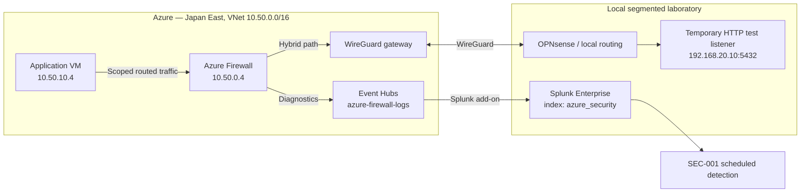

# 03 — Target and Implemented Security Architecture

**Architecture baseline:** Current laboratory implementation, 3 November 2026 | **Region:** Japan East | **View:** Logical security architecture, not a packet capture.

## 1. Architecture rationale

The architecture separates four concerns: **hybrid transport**, **network policy enforcement**, **security-event delivery**, and **SIEM detection**. A working tunnel is not treated as an authorization mechanism, and event ingestion is not equated with comprehensive detection coverage.

## 2. Implemented logical topology

**Diagram caveat:** This is a logical control-and-telemetry model. The exact next hop and inspection path for each packet must be evaluated against effective routes, NAT and firewall policy; the diagram does not independently prove universal firewall traversal.

## 3. Network zones and trust boundaries

| Boundary | Objective | Enforcement / review |
|---|---|---|
| Azure application subnet → Azure security network | Apply selected service restrictions | Azure Firewall Policy; NSG; UDR review |
| Azure → local segmented lab | Maintain controlled hybrid reachability | WireGuard transport; OPNsense and route review |
| Local management → cloud workload | Limit privileged access | Source-scoped policies; management evidence reviewed separately |
| Azure Firewall → Event Hubs | Deliver security decisions | Azure Firewall diagnostics |
| Event Hubs → Splunk | Consume logs with scoped privilege | Event Hub-scoped Data Receiver role and Splunk add-on |

The local test endpoint on TCP/5432 was an **HTTP listener**. It is deliberately not described as a deployed database or a successful database authentication flow.

## 4. Routing and traffic intent

| Path | Expected policy | Recorded evidence | Limit |
|---|---|---|---|
| APP `10.50.10.4` → local listener `192.168.20.10:5432` | Permit approved test flow | AZ-01: 3/3 connections | Selected TCP reachability only |
| Selected Azure → local TCP/4444 | Deny unauthorized service | AZ-02: denied events in Splunk | No claim of every port blocked |
| Private-network outbound NSG evaluation | Deny under restrictive NSG rule | AZ-04: Network Watcher returned Deny | NSG decision, not end-to-end traversal |
| Firewall diagnostics → Event Hubs → Splunk | Deliver and index security events | AZ-05: events observed in `azure_security` | No resilience test |
| Splunk scheduled correlation | Alert on repeated denials | AZ-03: SEC-001 triggered | Alert executions ≠ distinct incidents |

For test-source/destination details, see [09 — Traffic Flow Matrix](09-security-traffic-flow-matrix.md).

## 5. Security policy design

**Default architecture principle:** explicitly approve necessary source/destination/port combinations and avoid broad hybrid access. Azure Firewall, NSGs, and local firewall policy are complementary; their scopes and evaluation paths are not interchangeable.

**Validation-time change control:** A temporary NSG rule used during testing was removed, and the selected outbound flow was reevaluated. Network Watcher returned Deny under `Deny-Private-Networks-Outbound`. This demonstrates cleanup and rule evaluation, **not** a confirmed pre-existing vulnerability.

## 6. Telemetry and detection architecture

Azure Firewall diagnostics (`AZFWNetworkRule`, `AZFWApplicationRule`, `AZFWNatRule`, `AZFWThreatIntel`) were sent through Event Hubs to Splunk Enterprise. The recorded ingestion used the Microsoft Cloud Services add-on and the `azure_security` index. SEC-001 was a scheduled detection for repeated denied connections; its trigger confirms an observed detection path at the test time.

**Identity design:** The ingestion principal used an Azure Event Hubs Data Receiver assignment scoped to the relevant Event Hub, rather than broad administrative access. **Checkpoint storage design:** HTTPS-only, TLS 1.2, anonymous blob access disabled. These are configuration observations, not adversarial validation.

## 7. Architecture decisions and trade-offs

| Choice | Benefit | Trade-off | ADR |
|---|---|---|---|
| WireGuard for hybrid link | Practical outbound-initiated connection under local CGNAT | Peer/key and forwarding governance remain important | ADR-02 |
| Azure Firewall plus NSG | Central policy with additional subnet-level restriction | Requires route and rule-order verification | ADR-01, ADR-03 |
| Event Hubs to Splunk | Decoupled telemetry delivery and local analysis | Adds event transport and ingestion dependencies | ADR-04 |
| Temporary test listener | Repeatable connectivity assertion without a database deployment | Cannot establish database authorization | ADR-06 |

## 8. Architecture assurance position

**Supported:** Selected hybrid reachability, firewall-deny visibility, Event Hub ingestion, SEC-001 trigger and NSG Deny decision.

**Not established:** Complete symmetric inspection, every APP/DB segmentation requirement, full management policy, production availability, or cost/teardown closure. This document replaces earlier proposal-stage topology statements as the **current architectural narrative** without changing historical test identifiers.

[Requirements](01-business-security-requirements.md) · [Risk Assessment](02-threat-model-risk-assessment.md) · [ADRs](04-architecture-decision-records.md) · [Validation](07-security-validation-evidence.md) · [Evidence](evidence/README.md).
