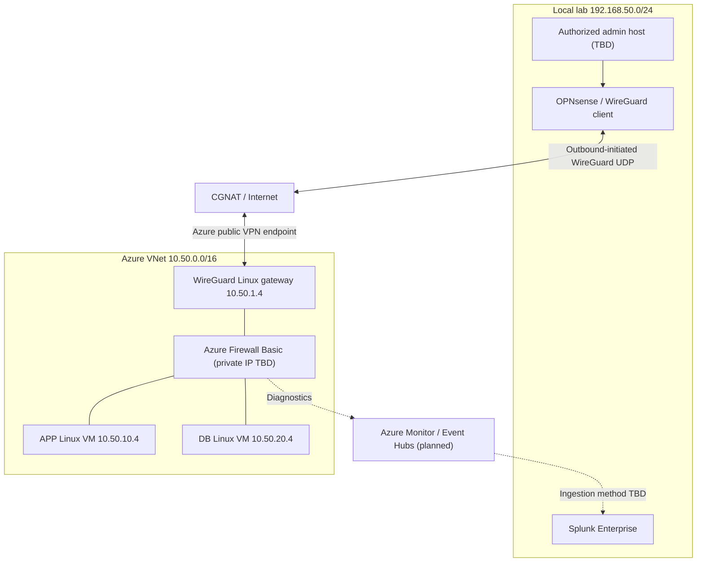
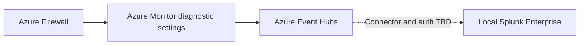

# 03 — Target Security Architecture

**Status:** Proposed; not deployed or tested. **Region:** UAE North (subject to availability).

Related documents: [Requirements](./01-business-security-requirements.md) and [Threat Model](./02-threat-model-risk-assessment.md).

## Purpose

Demonstrate least-privilege segmentation between Azure application and database workloads, controlled local administration through an outbound-initiated WireGuard tunnel, and security-event visibility in local Splunk. All claims remain design intentions until supported by actual configuration and test evidence.

## Proposed topology

Lines represent intended connections, not proof of traffic permissions or firewall traversal.

## Network and address plan

| Zone | Subnet | Endpoint |
|---|---|---|
| AzureFirewallSubnet | 10.50.0.0/26 | Firewall private IP assigned by Azure |
| AzureFirewallManagementSubnet | 10.50.0.64/26 | Dedicated firewall management interface |
| VPN | 10.50.1.0/27 | WireGuard VM 10.50.1.4 |
| APP | 10.50.10.0/24 | APP VM 10.50.10.4 |
| DB | 10.50.20.0/24 | DB VM 10.50.20.4 |
| WireGuard tunnel | 172.27.50.0/24 | Azure .1, local .2 |
| Local lab | 192.168.50.0/24 | Admin host TBD |

All addresses are proposed. Azure Firewall Basic public/management IP requirements and total billable public IP count must be verified.

## Trust boundaries

- TB-01 Internet to Azure WireGuard endpoint: authenticate peers and restrict exposed UDP.
- TB-02 Local management to WireGuard: allow only approved host and routed prefixes.
- TB-03 VPN gateway to Azure workloads: force selected flows through firewall, verify forwarding and return routes.
- TB-04 APP to DB: least-privilege service rule, independent NSG and host controls.
- TB-05 Azure diagnostic events to local Splunk: authenticated transport, data integrity, monitoring of missing events.

## Proposed UDR matrix

| Route table | Attached subnet | Destination | Virtual appliance next hop |
|---|---|---|---|
| RT-APP | APP | 10.50.20.0/24 | Azure Firewall private IP |
| RT-APP | APP | 192.168.50.0/24 | Azure Firewall private IP |
| RT-DB | DB | 10.50.10.0/24 | Azure Firewall private IP |
| RT-DB | DB | 192.168.50.0/24 | Azure Firewall private IP |
| RT-WG | VPN | 10.50.10.0/24 | Azure Firewall private IP |
| RT-WG | VPN | 10.50.20.0/24 | Azure Firewall private IP |
| RT-FW | AzureFirewallSubnet | 192.168.50.0/24 | WireGuard VM 10.50.1.4 |
| RT-FW | AzureFirewallSubnet | 172.27.50.0/24 (only if required) | WireGuard VM 10.50.1.4 |

Do not attach RT-FW to AzureFirewallManagementSubnet. Validate Azure Firewall SKU-specific routing constraints before deployment. An Azure system route can bypass inspection unless the relevant effective UDR is present.

## Bidirectional packet walks

**PATH-01: Local admin to APP SSH (intended allow).** The authorized local host sends TCP 22 through OPNsense and its client-initiated WireGuard tunnel. The Azure gateway decapsulates and preserves source 192.168.50.x. RT-WG sends traffic to Azure Firewall, whose policy allows the specified source to APP. APP replies through RT-APP to Azure Firewall, then RT-FW toward the WireGuard gateway and local host. Evidence must include effective routes, handshake, SSH success, and matching firewall Allow log.

**PATH-02: Local to DB SSH (intended deny).** The same inspected path reaches the Azure Firewall deny policy. A failed SSH connection alone does not prove Azure Firewall enforcement; a correlated Deny event and route/policy inspection are required.

**PATH-03: APP to DB TCP 5432 (intended allow).** APP routes to Azure Firewall, which permits a temporary TCP test listener on DB; return traffic follows DB's UDR. This does not imply PostgreSQL is installed.

**PATH-04: APP to DB SSH (intended deny).** Firewall blocks an unapproved new session. Correlated Deny log and effective route required.

All paths: **Not Tested**. WireGuard AllowedIPs, OPNsense routes, Linux IP forwarding, Azure NIC IP forwarding, and any NAT must be explicitly configured and inspected. If traffic is SNATed, source-scoped rules and return routes require redesign.

## Firewall policy intent

| Policy | Source | Destination | Port | Decision |
|---|---|---|---|---|
| FW-01 | APP | DB | TCP 5432 | Allow |
| FW-02 | APP | DB | Other new sessions | Deny |
| FW-03 | DB | APP | Unapproved new sessions | Deny |
| FW-04 | Approved local admin host | APP | TCP 22 | Allow |
| FW-05 | Local management | DB | TCP 22 | Deny |
| FW-06 | Internet | APP/DB management | TCP 22 | No direct exposure |
| FW-07 | All other traffic | All | Unapproved | Default deny where policy applies |

Firewall is stateful. NSGs or host firewalls may deny packets before they reach Azure Firewall; therefore missing Azure Firewall logs cannot be treated as proof of Azure Firewall enforcement. Explicit Internet egress routing, DNS, and service dependencies remain to be designed.

## Monitoring architecture

Ingestion feasibility, consumer authentication, transport, event categories, and costs remain open. The local Splunk consumer may initiate outbound connections, but that is not verified in this project.

## Assurance and deployment blockers

| ID | Blocker | Required review |
|---|---|---|
| ARCH-01 | Azure Firewall Basic and management/public IP prerequisites | Official SKU/region and subscription checks |
| ARCH-02 | UDR support, effective routes and symmetry | Bidirectional route validation |
| ARCH-03 | WireGuard AllowedIPs, forwarding, NAT, local firewall | Offline configuration and packet-path review |
| ARCH-04 | Event Hubs to local Splunk ingestion | Connector and authentication feasibility |
| ARCH-05 | Management host IP, rule priorities, NSG/host precedence | Detailed implementation plan |
| ARCH-06 | Trial eligibility, cost ceiling SAR 150, teardown | Cost model and cleanup checklist |

Planned evidence: NET-01/02/03, VPN-01/02/03, ROUTE-01, LOG-01 and GOV-01 as defined in requirements. Every test remains **Not Tested**.

**Architect review:** Design baseline documented, but **NOT approved for Azure deployment**. Next create ADRs and resolve the routing, ingestion and cost blockers before cloud activation.
