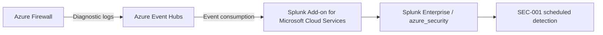

# 06 — Implemented Security Controls

## Purpose and scope

This document records the security architecture controls implemented or observed in the Azure-to-local laboratory. It describes **control objectives, enforcement boundaries, design decisions and assurance evidence**, not deployment commands. Results apply to the selected test paths, not to a production environment.

## Architecture control matrix

| Control area | Implemented architecture response | Security objective | Validation reference |
|---|---|---|---|
| Hybrid connectivity | WireGuard tunnel between Azure and the local segmented laboratory | Establish controlled routed connectivity across the cloud/local trust boundary | AZ-01; [hybrid routing evidence](./evidence/README.md) |
| Cloud network enforcement | Azure Firewall Policy and subnet-level NSG rules | Permit scoped required flows and restrict unauthorized destinations/services | AZ-01, AZ-02, AZ-04 |
| Route governance | Azure route tables and verified effective routes / associations | Make intended traffic paths explicit and subject to security enforcement | [routing evidence](./evidence/README.md) |
| Firewall telemetry | Azure Firewall diagnostic categories streamed to Azure Event Hubs | Retain security-relevant network policy observations for analysis | AZ-05 |
| Centralized monitoring | Splunk Enterprise ingests Event Hub telemetry into `azure_security` | Provide searchable cloud firewall events in a centralized SIEM | AZ-05 |
| Detection | SEC-001 scheduled correlation alert for repeated denied connections | Detect recurring network policy denials in indexed events | AZ-03 |
| Ingestion access | Event Hub-scoped Azure Event Hubs Data Receiver assignment for the ingestion identity | Restrict event-consumption permissions to the required resource | Recorded configuration |
| Checkpoint transport | Storage HTTPS-only, TLS 1.2 and anonymous blob access disabled | Reduce exposure of ingestion checkpoint storage | Recorded configuration |

## Network security and trust boundaries

The Azure virtual network uses the `10.50.0.0/16` address space. The application test VM is `10.50.10.4`; Azure Firewall has private address `10.50.0.4`. A WireGuard gateway connects the Azure environment to the local segmented lab. Routing and policy enforcement are separate design concerns: an established tunnel does not imply that every service or destination is authorized.

A temporary HTTP listener at `192.168.20.10:5432` served as a connectivity target. **Three of three** recorded TCP connection tests succeeded. This demonstrates selected TCP reachability only; no PostgreSQL deployment, database authentication, or application authorization is claimed.

A separate TCP/4444 test produced denied firewall events, which were observed in Splunk. After the temporary NSG test exception was removed, Network Watcher IP flow verification reported **Deny** under `Deny-Private-Networks-Outbound`. The latter result establishes the evaluated NSG rule decision, not an independent end-to-end packet traversal.

## Monitoring architecture

The recorded diagnostics include `AZFWNetworkRule`, `AZFWApplicationRule`, `AZFWNatRule`, and `AZFWThreatIntel`. SEC-001 triggered during the 3 November 2026 laboratory validation. Repeated alert executions are not represented as separate confirmed incidents.

## Architecture decisions and assurance

The design combines network segmentation and restrictive policies with centralized visibility. The key architectural trade-off is to maintain practical hybrid connectivity without treating the tunnel as a blanket authorization boundary. Event Hubs separates Azure event production from SIEM consumption; a receiver-scoped identity reduces unnecessary privileges.

The implemented controls and recorded configuration are **not** a claim of comprehensive network assurance or production compliance. For evidence and test-specific conclusions, consult the linked documents.

[Architecture](03-target-security-architecture.md) · [ADRs](04-architecture-decision-records.md) · [Traffic Matrix](09-security-traffic-flow-matrix.md) · [Validation](07-security-validation-evidence.md) · [Evidence Register](evidence/README.md)
