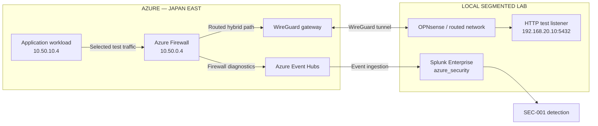

# Enterprise Security Architecture — Microsoft Azure & Splunk Enterprise

**Security Architecture | Hybrid Networking | Azure Firewall | SIEM Integration | Detection Engineering**

An end-to-end **security architecture case study** covering requirements, risk-informed design, hybrid network enforcement, centralized security telemetry, and evidence-based control validation. The project focuses on **architecture decisions and assurance**, not publishing deployment scripts or configuration commands.

> **Scope:** An independently implemented Azure-to-local laboratory with selected security controls tested on 3 November 2026. Findings and conclusions are limited to the documented test paths; this is not a production deployment or a comprehensive security certification.

## Project Highlights

- Designed and implemented routed hybrid connectivity between an Azure application workload and a segmented local laboratory using WireGuard.
- Applied Azure Firewall Policy and NSG restrictions to selected authorized and unauthorized traffic.
- Verified **3/3** TCP/5432 connections to a temporary **HTTP test listener** in the local lab; no PostgreSQL database was deployed.
- Observed denied TCP/4444 events in Splunk through an Azure Firewall → Event Hubs → Splunk telemetry pipeline.
- Implemented and tested **SEC-001**, a scheduled correlation alert for repeated firewall denials.
- Removed a temporary NSG test exception and confirmed a **Deny** decision using Network Watcher IP flow verification.
- Documented architecture decisions, trust boundaries, threat scenarios, attack paths, validation results, and assurance traceability.

## Architecture Overview

**Interpretation:** The diagram is a logical security architecture overview, not a packet-level assertion that all traffic traverses every depicted enforcement hop. Effective routing, policy scope and observed events are assessed separately in the [traffic flow matrix](09-security-traffic-flow-matrix.md).

### Trust boundaries and security principles

| Boundary | Architecture objective | Control / decision |
|---|---|---|
| Azure application → routed network | Restrict workloads to approved destinations and services | Azure Firewall Policy and NSG |
| Azure ↔ local lab | Provide hybrid connectivity without granting blanket network access | WireGuard and explicit routing |
| Azure Firewall → telemetry transport | Make security decisions observable | Azure Firewall diagnostic settings and Event Hubs |
| Event Hubs → Splunk | Consume security telemetry with limited privileges | Event Hub-scoped Data Receiver role |
| Splunk events → detection | Turn denied-connection patterns into reviewable alerts | SEC-001 scheduled correlation |

## Security Validation Results

| Test | Expected security behavior | Observed result | Conclusion |
|---|---|---|---|
| AZ-01 | Permit selected Azure-to-local service | **3/3** TCP/5432 connections succeeded | Pass for TCP reachability |
| AZ-02 | Deny unapproved TCP/4444 test flow | Denied events appeared in Splunk | Pass for tested deny-event visibility |
| AZ-03 | Detect repeated denied connections | SEC-001 scheduled alert triggered | Pass for observed alert execution |
| AZ-04 | Restrict selected private-network outbound flow | Network Watcher returned **Deny** after test-rule removal | Pass for evaluated NSG rule decision |
| AZ-05 | Centralize Azure Firewall telemetry | Events indexed in Splunk through Event Hubs | Pass for observed ingestion pipeline |

**Evidence:** [View all 15 uploaded screenshots](evidence/README.md). All images are retained; the repository owner has confirmed a privacy review, while evidence relevance is being assessed; not every screenshot is necessarily independent evidence for an Azure control.

## Security Validation Finding and Corrective Action

**AZ-F-01 — Temporary NSG validation rule: cleanup and post-test verification.** A temporary test exception was removed after validation, and the selected private-network outbound flow was reevaluated using Network Watcher. The resulting decision was **Deny** under `Deny-Private-Networks-Outbound`.

**Architectural lesson:** Temporary validation rules require explicit cleanup and post-change verification. This is a documented lab control-correction exercise, **not** evidence of an exploited vulnerability or production security incident.

[Security Assessment Findings](08-security-assessment-findings.md) · [Attack Path Analysis](12-attack-path-analysis.md)

## Architecture Decisions

- **Hybrid connectivity:** WireGuard provided a practical cloud-to-local tunnel while keeping authorization decisions at explicit network enforcement points.
- **Layered enforcement:** Azure Firewall and NSG provide complementary controls with distinct policy scopes.
- **Monitoring architecture:** Event Hubs decouples Azure diagnostic event production from Splunk ingestion and correlation.
- **Least privilege:** The Splunk ingestion identity was assigned the Event Hubs Data Receiver role at the specific Event Hub scope.
- **Test realism:** A temporary HTTP listener was used to validate network connectivity; no database-level access claims are made.

[Full Architecture Decision Records](04-architecture-decision-records.md)

## Security Assurance

The evidence supports selected hybrid connectivity, denied-traffic visibility, centralized log ingestion, a triggered detection, and an NSG rule decision. It does **not** establish complete segmentation across every port and host, application authentication, resilience under failure, or production readiness.

[Requirements Traceability](10-requirements-traceability-matrix.md) · [Security Assurance Report](13-security-assurance-report.md)

## Project Documentation

The project follows a requirements-to-assurance security architecture lifecycle. Documents 01–05 preserve the original planning baseline and include a current-state reconciliation; 06–13 document implementation outcomes, analysis, and assurance.

| # | Document | Purpose |
|---|---|---|
| 01 | [Business & Security Requirements](01-business-security-requirements.md) | Business objectives, security requirements and original scope |
| 02 | [Threat Model & Risk Assessment](02-threat-model-risk-assessment.md) | Initial threat scenarios, risks and treatment priorities |
| 03 | [Target Security Architecture](03-target-security-architecture.md) | Original design and current logical hybrid architecture |
| 04 | [Architecture Decision Records](04-architecture-decision-records.md) | Alternatives, decisions, trade-offs and observed outcomes |
| 05 | [Implementation & Validation Readiness Plan](05-implementation-validation-readiness-plan.md) | Historical execution gates and current validation reconciliation |
| 06 | [Implemented Security Controls](06-implemented-security-controls.md) | Control objectives, trust boundaries and implementation evidence |
| 07 | [Security Validation Evidence](07-security-validation-evidence.md) | Executed tests, observations and validation interpretation |
| 08 | [Security Assessment Findings](08-security-assessment-findings.md) | Findings, corrective actions and assurance implications |
| 09 | [Security Traffic Flow Matrix](09-security-traffic-flow-matrix.md) | Approved/denied test flows and telemetry paths |
| 10 | [Requirements Traceability Matrix](10-requirements-traceability-matrix.md) | Objective-to-control-to-test-to-evidence traceability |
| 11 | [STRIDE Threat Model](11-stride-threat-model.md) | Detailed threats across hybrid and monitoring trust boundaries |
| 12 | [Attack Path Analysis](12-attack-path-analysis.md) | Analytical attack paths and control assessment |
| 13 | [Security Assurance Report](13-security-assurance-report.md) | Evidence-based assurance conclusion |

**[Evidence Register — 15 uploaded screenshots](evidence/README.md)**

---

*Independent educational laboratory. Published architecture descriptions and validation records are limited to observed or explicitly identified proposed outcomes. No credentials, source templates, or operational deployment commands are included in this case study.*
