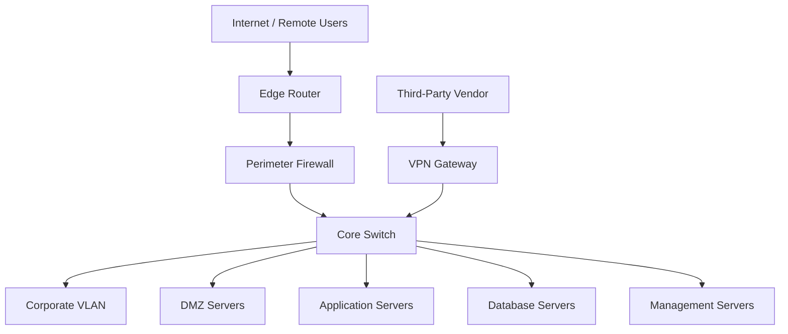

# Current Network Architecture

## 1. Overview

This document presents the fictional enterprise network architecture before the security assessment and redesign.

The environment uses a perimeter firewall and a core switch to connect multiple internal network segments.

## 2. Architecture Diagram

## 3. Existing Components

| Component | Purpose |
|---|---|
| Edge Router | Internet connectivity |
| Perimeter Firewall | External traffic filtering |
| Core Switch | Internal network connectivity |
| VPN Gateway | Remote vendor access |
| Corporate VLAN | Employee workstations |
| DMZ Servers | Externally accessible services |
| Application Servers | Business applications |
| Database Servers | Critical business data |
| Management Servers | Administrative services |

## 4. Assessment Scope

The security assessment will examine:

- Network segmentation and trust boundaries.
- Inter-zone communication and firewall enforcement.
- Remote access and third-party connectivity.
- Database and management network exposure.
- Logging, monitoring, and administrative access controls.

## 5. Assessment Status

Architecture documented. Security findings pending traffic flow and access-control review.

## Disclaimer

This is a fictional network architecture created for security assessment and educational purposes.
