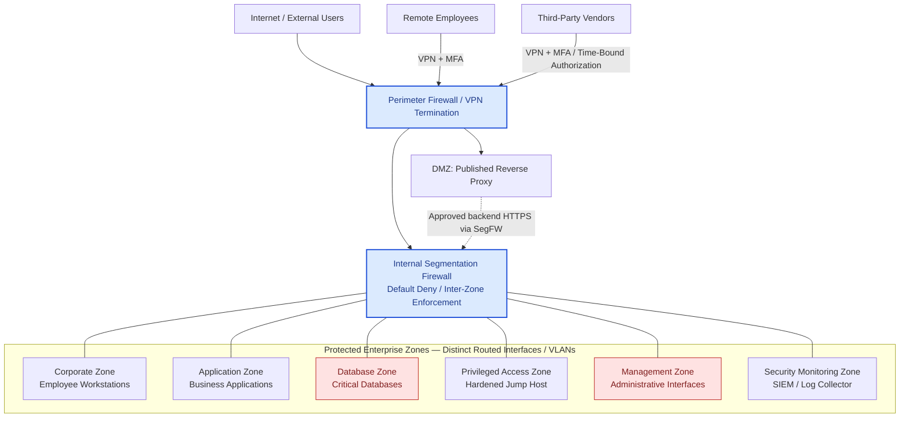

# Proposed Secure Network Architecture

## 1. Objective and Scope

This proposed logical architecture addresses the fictional Enterprise X findings F-01 through F-04. It separates enterprise security zones, establishes controlled access paths, and defines where inter-zone policy enforcement occurs.

**Status:** Proposed design only. No controls have been deployed or tested.

## 2. Logical Architecture

**Diagram interpretation:** Connections from zones to the segmentation firewall represent enforcement attachment, **not blanket permission**. No direct zone-to-zone links are shown. Permitted flows must traverse the segmentation firewall. The DMZ-to-application path is subject to firewall rules. Remote user and vendor sessions must be classified and restricted by identity and policy before reaching internal destinations.

## 3. Trust Boundaries and Enforcement

| Boundary | Enforcement Point | Policy Intent |
|---|---|---|
| Internet / enterprise edge | Perimeter firewall | Expose only approved public services and remote-access entry points |
| Remote user / internal zones | VPN identity controls + segmentation firewall | MFA and destination-specific authorization |
| Vendor / internal zones | VPN identity controls + segmentation firewall | Time-bound access to the privileged access zone only |
| Corporate / Application | Segmentation firewall | Permit approved HTTPS applications only |
| Application / Database | Segmentation firewall | Permit approved application hosts to database services only |
| Privileged Access / Management | Segmentation firewall | Permit approved administrative protocols to specific management targets |
| Other inter-zone traffic | Segmentation firewall | Deny by default; log according to policy |

**Routing requirement:** Each protected zone must use a topology and routing design that ensures inter-zone traffic crosses the segmentation firewall. A shared core switch is acceptable only if VLANs, gateways, routing, and ACLs do not create bypass paths. This is a logical design; detailed routing and HA design remain out of scope.

## 4. Proposed Access Policy — High-Level

| Flow | Source | Destination | Service | Target Action | Related Finding |
|---|---|---|---|---|---|
| P-01 | Corporate workstations | Approved application hosts | TCP/443 | Allow, scoped | Business requirement |
| P-02 | Corporate workstations | Database Zone | TCP/1433 | Deny | F-02 |
| P-03 | Approved application hosts | Approved database hosts | TCP/1433 | Allow, scoped | F-02 |
| P-04 | Vendor remote-access identity group | Privileged Access Zone | Approved access service | Allow only with MFA, authorization and expiry | F-01, F-04 |
| P-05 | Vendor remote-access identity group | Database Zone | Any | Deny | F-01 |
| P-06 | Standard corporate workstations | Management Zone | Any | Deny | F-03 |
| P-07 | Hardened jump host | Approved management targets | Approved admin protocols | Allow, scoped and logged | F-03, F-04 |
| P-08 | Public clients | Approved DMZ reverse proxy | TCP/443 | Allow, scoped | Published service |
| P-09 | DMZ reverse proxy | Approved application backend | TCP/443 | Allow, scoped | Published service |
| P-10 | Any other unapproved inter-zone source | Other protected zones | Any | Deny by default | All |

The exact source/destination addresses, protocol exceptions, inspection profiles, and logging details require implementation design and application-owner approval. No implicit permission exists simply because a zone connects to a firewall.

## 5. Security Controls

### 5.1 Segmentation and Database Protection
- Route all protected inter-zone traffic through the internal segmentation firewall.
- Enforce least-privilege policies using explicit source, destination, and service criteria.
- Deny corporate and vendor direct access to database services.
- Permit database access from explicitly approved application hosts; separately authorize any required database administration.

### 5.2 Remote and Third-Party Access
- Terminate remote access at a controlled gateway with MFA and identity-aware authorization.
- Assign vendor users to a restricted access policy that exposes only the approved privileged access service.
- Enforce time-bound vendor access and promptly revoke expired authorization.
- Validate vendor device posture and session monitoring requirements during detailed design.

### 5.3 Privileged Administration
- Place a hardened jump host in a dedicated Privileged Access Zone.
- Allow administrative access from the jump host only to explicitly approved management targets and protocols.
- Restrict jump-host administration and log privileged sessions where supported.
- Evaluate high availability and emergency access to avoid operational lockout.

### 5.4 Monitoring
- Centralize relevant firewall, VPN, identity, jump-host, and system events in the SIEM or log collector.
- Define collection paths and log transport controls during implementation design.
- Alert on denied database access, unauthorized management attempts, failed MFA, and expired vendor access attempts.

## 6. Finding-to-Control Mapping

| Finding | Design Response | Validation Reference |
|---|---|---|
| F-01: Excessive vendor database access | Vendor access restricted to privileged access zone; database denied | TC-02, TC-08 |
| F-02: Corporate database access | Corporate-to-database denied; approved application-to-database permitted | TC-01, TC-03 |
| F-03: Corporate management access | Corporate-to-management denied; scoped jump-host access | TC-04, TC-06 |
| F-04: Vendor RDP controls unverified | MFA, time-bound authorization, controlled administrative path | TC-05, TC-06, TC-08 |

## 7. Open Design Decisions and Limitations

1. **High availability:** Firewall, VPN, and jump-host redundancy and failover behavior require design.
2. **Detailed routing:** Interface placement, VLANs, gateways, and anti-bypass verification require implementation diagrams.
3. **Identity:** MFA provider, role mapping, device posture, and emergency access require specification.
4. **Published services:** Reverse proxy/WAF selection, backend authentication, and application security controls require review.
5. **Operational dependencies:** DNS, AD, NTP, patching, backups, and monitoring flows must be added to the full target-state matrix.
6. **Security validation:** No test has been executed; all related test cases remain Not Tested.

## 8. Next Step

Produce a complete target-state traffic flow matrix with policy owners, source/destination objects, approved services, logging requirements, and explicit deny rules. Review the logical diagram against routing and HA assumptions before claiming implementation readiness.

## Disclaimer

Enterprise X and all architecture elements are fictional. This document is an independently developed portfolio case study, not evidence of a deployed or validated production environment.
