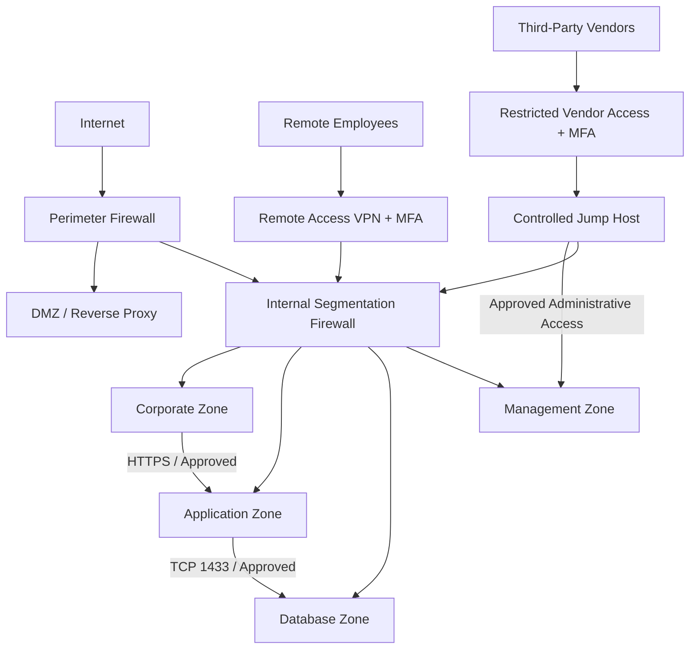

# Proposed Secure Network Architecture

## 1. Objective

Redesign the fictional Enterprise X network to address identified security risks while maintaining required business connectivity.

The architecture follows defense-in-depth, least-privilege, and network segmentation principles.

## 2. Proposed Architecture

## 3. Proposed Security Controls

### Network Segmentation
- Enforce inter-zone access policies through an internal segmentation firewall.
- Deny unauthorized communication by default.
- Permit only documented and approved business traffic.

### Database Protection
- Deny direct access from standard corporate workstations.
- Permit authorized application servers to access approved database services.
- Restrict database administration to designated privileged access paths.

### Third-Party Access
- Enforce MFA and identity-based authorization.
- Restrict vendor access to explicitly approved destinations.
- Apply time-bound access and session monitoring where appropriate.
- Prohibit direct vendor-to-database connectivity.

### Privileged Administration
- Introduce a controlled jump host.
- Separate administrative access from standard corporate access.
- Apply least-privilege administrative permissions.
- Log privileged access activities.

### Monitoring
- Forward relevant firewall, VPN, identity, and administrative logs to a centralized monitoring platform.
- Monitor denied inter-zone traffic and suspicious access attempts.
- Define alerting requirements for critical security events.

## 4. Finding-to-Control Mapping

| Finding | Proposed Control | Expected Outcome |
|---|---|---|
| F-01 | Restricted vendor access and database isolation | Prevent direct vendor database connectivity |
| F-02 | Application-to-database allowlisting | Prevent direct corporate database access |
| F-03 | Dedicated management zone and controlled jump host | Reduce unauthorized management exposure |
| F-04 | MFA, restricted RDP, session monitoring | Reduce vendor privileged-access risk |

## 5. Design Assumptions

- This is a logical reference architecture, not a physical implementation diagram.
- Firewall policies will enforce approved inter-zone flows.
- Access paths require additional implementation-level design.
- Availability, redundancy, and operational constraints require further review.
- Security controls are proposed and have not been deployed or tested.

## 6. Next Steps

- Document Architecture Decision Records.
- Define the target-state traffic flow matrix.
- Develop a security validation and acceptance plan.
- Review residual risks and remaining design limitations.

## Disclaimer

This architecture is a fictional case study developed for educational and portfolio purposes.
