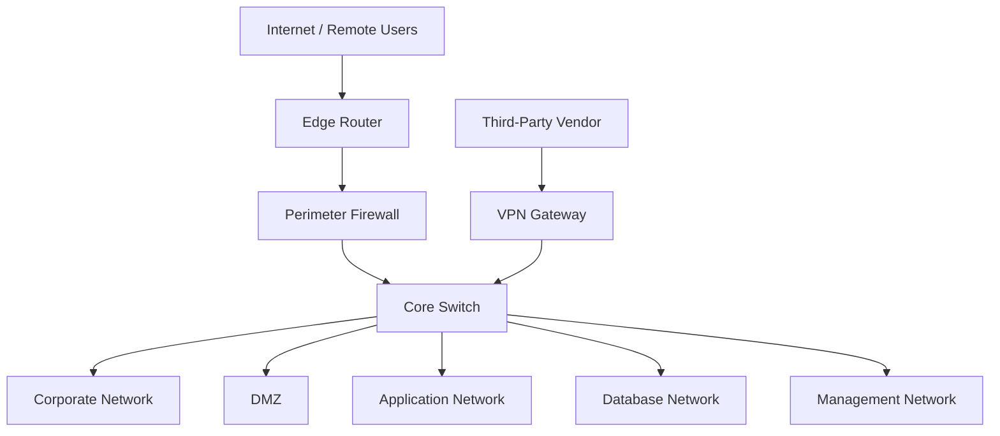

# Current Network Architecture (As-Is)

## 1. Overview

This document describes the assumed current-state network architecture of Enterprise X, a fictional organization used as the business scenario for this security architecture portfolio project.

The purpose of this baseline is to identify potential security weaknesses, define trust boundaries, and establish the requirements for a more secure network design.

**Important:** The architecture below is a hypothetical assessment scenario. It was not deployed in the VirtualBox laboratory.

## 2. Assumed Current-State Architecture

The diagram represents a simplified enterprise environment where multiple internal networks are connected through shared infrastructure.

Network separation alone does not guarantee effective security. The assessment must determine whether traffic between zones is explicitly restricted and monitored.

## 3. Assumed Infrastructure Components

| Component | Purpose | Lab Deployment |
|---|---|---|
| Edge Router | External network connectivity | Not deployed as a separate device |
| Perimeter Firewall | External traffic filtering | Represented conceptually |
| Core Switch | Internal network connectivity | Not deployed |
| VPN Gateway | Remote access connectivity | Not deployed |
| Corporate Network | Employee endpoints | Not deployed |
| DMZ | Externally accessible services | Not deployed |
| Application Network | Business application workloads | Simulated |
| Database Network | Database workloads | Simulated |
| Management Network | Administrative access | Simulated |

The implemented laboratory uses OPNsense as the security gateway between three dedicated networks: APP, DB, and MGMT.

## 4. Trust Boundaries

The assumed enterprise environment contains several security boundaries that require assessment:

- Internet to internal enterprise services.
- Corporate users to application and database services.
- Application systems to database systems.
- Application and database networks to management services.
- Third-party access to internal infrastructure.

The practical laboratory focuses on application-to-database communication and management access isolation.

## 5. Potential Security Concerns

The following are assessment hypotheses, not confirmed findings from a deployed enterprise network.

| ID | Potential Concern | Security Impact |
|---|---|---|
| H-01 | Excessive communication between internal network zones | Increased lateral movement opportunities |
| H-02 | Broad application-to-database access | Unnecessary exposure of database services |
| H-03 | Application or database access to management interfaces | Increased administrative attack surface |
| H-04 | Insufficient firewall rule validation | Unintended traffic may remain permitted |
| H-05 | Inadequate visibility into denied and permitted traffic | Reduced ability to verify security enforcement |

These hypotheses provide the basis for the subsequent security assessment, risk analysis, and secure architecture design.

## 6. Assessment Scope

The architecture assessment considers:

- Network segmentation and trust boundaries.
- Least-privilege inter-zone communication.
- Database network exposure.
- Administrative interface isolation.
- Firewall rule enforcement.
- Security logging and validation.

Remote-access VPN, MFA, vendor connectivity, corporate segmentation, and DMZ controls are architectural considerations outside the practical laboratory scope.

## 7. Assessment Outcome

The assumed baseline highlights the importance of explicitly controlling traffic between security zones.

The project addresses selected risks through a practical VirtualBox laboratory using:

- OPNsense firewall
- Debian application server
- Debian database test server
- Kali Linux management workstation

The laboratory validates selected allow and deny policies using TCP connectivity testing and firewall logs.

Detailed target-state architecture, firewall policies, and validation results are documented separately in the project.

## 8. Disclaimer

Enterprise X and its current-state network are fictional.

The current-state diagram is an illustrative assessment baseline, not evidence of a real network deployment or an observed production security weakness.
