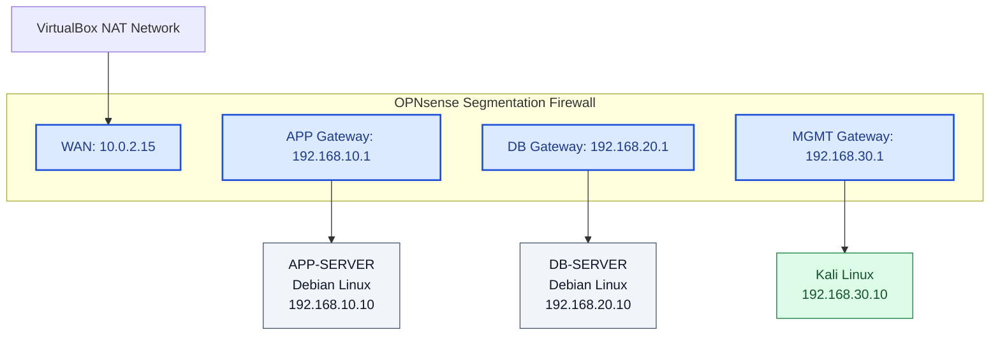
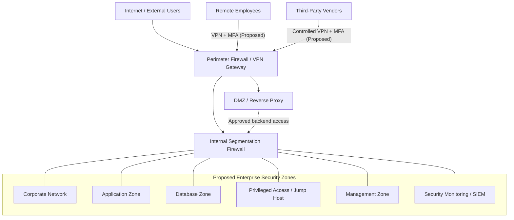

# Secure Network Architecture — Implemented Lab & Enterprise Target Design

## 1. Architecture Objective

This document presents two complementary security architecture designs:

1. **Implemented Laboratory Architecture:** A segmented network deployed and validated using OPNsense, Debian Linux, Kali Linux, and VirtualBox.
2. **Proposed Enterprise Target Architecture:** A conceptual security architecture for Enterprise X, a fictional organization requiring broader network segmentation, privileged access, remote access, and security monitoring controls.

The project demonstrates how security requirements and risk assessment findings can be translated into technical security designs and validated through practical testing.

## 2. Implemented Laboratory Architecture

### 2.1 Network Topology

**Topology Interpretation:**

- Each security zone is connected to a dedicated OPNsense firewall interface.
- OPNsense provides the Layer 3 gateways and inter-zone policy enforcement.
- Inter-zone communication is subject to firewall rules.
- The WAN interface uses VirtualBox NAT connectivity.
- The laboratory does not include separate enterprise routers, core switches, or a deployed DMZ.

### 2.2 Network Addressing

| Interface | Security Zone | Gateway IP | Connected System |
|---|---|---|---|
| em0 | WAN | 10.0.2.15 (NAT-assigned interface address) | VirtualBox NAT |
| em1 | APP | 192.168.10.1/24 | APP-SERVER — 192.168.10.10 |
| em2 | DB | 192.168.20.1/24 | DB-SERVER — 192.168.20.10 |
| em3 | MGMT | 192.168.30.1/24 | Kali Linux — 192.168.30.10 |

### 2.3 Security Zones

**Application Zone (APP)**

Contains a Debian Linux server representing an application workload.

Only explicitly authorized communication to the database test endpoint is permitted.

**Database Zone (DB)**

Contains a Debian Linux server representing a protected database workload.

A temporary Python TCP listener on port 5432 was used to simulate database service connectivity.

A production PostgreSQL database was not deployed.

**Management Zone (MGMT)**

Contains the Kali Linux workstation used to administer the OPNsense firewall through HTTPS.

Administrative access is restricted to the designated management workstation for the tested access paths.

## 3. Implemented Firewall Security Policies

| Policy ID | Source | Destination | Service | Action |
|---|---|---|---|---|
| FW-01 | APP-SERVER | DB-SERVER | TCP/5432 | Allow |
| FW-02 | APP-SERVER | DB-SERVER | TCP/5433 | Deny by default |
| FW-03 | APP-SERVER | OPNsense MGMT | TCP/443 | Deny by default after remediation |
| FW-04 | DB-SERVER | OPNsense MGMT | TCP/443 | Deny intended; connectivity failed |
| FW-05 | Kali Linux | OPNsense MGMT | TCP/443 | Allow |

**Firewall Policy Principles:**

- Least-privilege access between security zones.
- Explicitly approved application-to-database communication.
- Default-deny behavior for unauthorized traffic.
- Restricted administrative interface access.
- Logging and validation of selected firewall decisions.

The tested policies demonstrate selected traffic restrictions; they do not establish that all possible inter-zone traffic is blocked.

## 4. Practical Security Validation

### 4.1 Validation Results

| Test ID | Source | Destination | Expected | Observed |
|---|---|---|---|---|
| LAB-01 | APP → DB TCP/5432 | Database test endpoint | Allow | Connected |
| LAB-02 | APP → DB TCP/5433 | Database test endpoint | Deny | Failed; firewall block logged |
| LAB-03 | APP → MGMT TCP/443 | Firewall management | Deny | Blocked; firewall log confirmed |
| LAB-04 | DB → MGMT TCP/443 | Firewall management | Deny | Failed; complete log correlation pending |
| LAB-05 | Kali → MGMT TCP/443 | Firewall management | Allow | Connected |

### 4.2 Security Finding: OPNsense Anti-Lockout Rule

During validation, APP-SERVER unexpectedly established a TCP connection to the OPNsense management interface.

Firewall log inspection identified the built-in anti-lockout rule as the permitting rule.

**Corrective Action:**

- Confirmed that authorized management access was available from Kali Linux.
- Disabled the OPNsense administration anti-lockout rule.
- Preserved the explicit management access policy.
- Repeated the APP-to-MGMT connectivity test.
- Verified that the unauthorized connection was blocked.

**Outcome:** The unintended management access path was removed for the tested APP-SERVER connection without disrupting authorized Kali Linux administration.

This demonstrates the importance of reviewing system-generated firewall rules in addition to manually configured policies.

## 5. Proposed Enterprise Target Architecture

The following design represents a future enterprise-scale architecture for Enterprise X.

**Status: Conceptual design only — not deployed or tested.**

### 5.1 Enterprise Logical Architecture

Connections to the segmentation firewall indicate logical enforcement boundaries, not unrestricted communication permissions.

### 5.2 Proposed Enterprise Security Controls

**Network Segmentation**
- Separate corporate, application, database, and management networks.
- Enforce least-privilege inter-zone firewall policies.
- Deny unauthorized direct access to critical databases.

**Remote and Third-Party Access**
- Enforce MFA for remote access.
- Restrict vendors to approved systems.
- Apply time-bound access authorization.
- Use controlled privileged-access paths.

**Privileged Administration**
- Deploy a hardened jump host.
- Restrict management access to approved administrative systems.
- Monitor privileged access activity.

**Security Monitoring**
- Centralize relevant firewall and system logs.
- Integrate security events with a SIEM.
- Define alerts for unauthorized access attempts.

**Resilience and Availability**
- Evaluate firewall high availability.
- Define backup and recovery requirements.
- Review routing dependencies and potential bypass paths.

## 6. Finding-to-Control Mapping

| Finding | Security Design Response | Implementation Status |
|---|---|---|
| F-01: Excessive vendor database access | Restricted third-party access and database isolation | Proposed |
| F-02: Direct corporate database access | Least-privilege application-to-database policies | Principle demonstrated in lab |
| F-03: Unrestricted management access | Dedicated management zone and controlled administration | Selected controls implemented |
| F-04: Vendor RDP controls unverified | MFA, controlled remote access, privileged access solution | Proposed |
| LAB-F-01: Anti-lockout management exposure | Remove unintended administrative access and validate firewall behavior | Remediated and validated |

## 7. Architecture Design Decisions

The implemented laboratory reflects the following decisions:

1. **Dedicated Security Zones:** Separate APP, DB, and MGMT into different network segments.
2. **Centralized Inter-Zone Enforcement:** Use OPNsense as the security gateway between segments.
3. **Least-Privilege Policies:** Permit only explicitly required application-to-database communication.
4. **Management Isolation:** Restrict firewall administration to the designated management workstation.
5. **Evidence-Based Validation:** Test actual network connectivity and inspect firewall logs.
6. **System Rule Review:** Include automatically generated firewall rules in security assurance activities.

## 8. Limitations and Future Enhancements

### Laboratory Limitations

- No production PostgreSQL service was deployed.
- The laboratory does not include a dedicated corporate network or DMZ.
- VPN, MFA, jump hosts, and SIEM integration were not implemented.
- No firewall high-availability configuration was tested.
- Validation covers selected TCP communication paths.
- No production systems or customer information were involved.

### Future Enhancements

- Implement database authentication and application-level access controls.
- Introduce centralized security logging.
- Expand testing to additional network protocols and traffic paths.
- Evaluate firewall high availability and recovery procedures.
- Introduce controlled privileged-access infrastructure.
- Assess remote-access and third-party security requirements.

## 9. Related Documentation

- `01-business-security-requirements.md`
- `02-current-architecture.md`
- `03-traffic-flow-matrix.md`
- `04-security-assessment-findings.md`
- `05-risk-assessment-register.md`
- `07-architecture-decision-records.md`
- `08-security-validation-plan.md`

## 10. Disclaimer

Enterprise X is a fictional organization.

The implemented laboratory is an independently developed educational environment.

The enterprise target architecture is conceptual and should not be interpreted as a deployed or production-validated security design.
