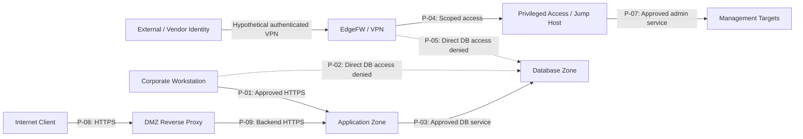

# Attack Path Analysis — Network Trust Boundaries

## 1. Purpose and Scope

This is a **conceptual, defensive attack-path review** for fictional Enterprise X and the isolated OPNsense lab. Paths illustrate how access could expand if identities, segmentation, or management-plane controls fail. They are not attack demonstrations, exploitation evidence, or claims that an attacker successfully traversed the paths.

The lab implements only APP, DB, MGMT, and OPNsense. Enterprise VPN, MFA, jump host, DMZ, SIEM, and production databases are **proposed, not deployed**.

## 2. Trust-Boundary Path Map

**Legend:** Solid arrows indicate **proposed, conditionally approved policy paths**, not tested sessions. Dashed arrows indicate **proposed deny policies**, not demonstrated firewall blocks. The enterprise SegFW is the intended enforcement boundary for internal inter-zone traffic (see P-01–P-12).

## 3. Scenario-Based Attack Paths

### AP-01 — Compromised Corporate Workstation to Database

- **Initial foothold:** A hypothetical compromised corporate workstation.
- **Potential progression:** Workstation → database service (direct), or workstation → approved application → database through an application weakness.
- **Intended controls:** P-02 denies direct DB access; P-01 and P-03 narrowly scope legitimate corporate-to-application and application-to-database flows; application/database authentication is still required.
- **What remains possible:** Network segmentation alone does not prevent application-layer misuse or stolen application credentials.
- **Evidence:** LAB-01/02 demonstrate selected lab port policy behavior only, **not** corporate endpoint containment or database authorization.
- **Status:** Hypothetical; not tested in enterprise.

### AP-02 — Vendor Remote Access to Privileged Systems

- **Initial foothold:** Hypothetically compromised vendor account or endpoint.
- **Potential progression:** Vendor → VPN → management or database systems, potentially bypassing a controlled privileged path.
- **Intended controls:** EdgeFW VPN + MFA and time-bound authorization (P-04); direct vendor-to-DB deny (P-05); jump-host-to-management scoping and logging (P-07).
- **Residual concern:** A compromised authorized jump-host session may still threaten approved management targets; session recording, privileged identity controls, and endpoint hardening remain necessary.
- **Evidence:** None for enterprise VPN, MFA, or jump host.
- **Status:** Hypothetical; not tested.

### AP-03 — Published Service to Internal Application

- **Initial foothold:** Internet-facing reverse proxy or published application.
- **Potential progression:** Internet → DMZ reverse proxy → application backend; additional movement could be attempted toward protected DB services.
- **Intended controls:** P-08 limits inbound HTTPS, P-09 restricts backend HTTPS, P-03 scopes DB access, and P-10 denies unapproved inter-zone flows.
- **Residual concern:** Approved paths still need application security, patching, service identity, and monitoring.
- **Evidence:** No DMZ or reverse-proxy lab implementation.
- **Status:** Hypothetical; not tested.

### AP-04 — Observed APP-to-Firewall Management Reachability (Lab)

- **Observed starting point:** APP-SERVER 192.168.10.10.
- **Sensitive destination:** OPNsense management interface 192.168.30.1:443.
- **Initial observation:** TCP connectivity unexpectedly succeeded; firewall logs attributed the pass to the built-in anti-lockout rule (LAB-03 / EV-03).
- **Corrective control:** Disabled anti-lockout after confirming authorized Kali management access; APP-to-management connection then blocked and logged (LAB-03 / EV-04).
- **What this does not prove:** No login, credential theft, privilege escalation, firewall compromise, or broader lateral movement was demonstrated.
- **Status:** Observed network exposure; remediated and retested for the specified path.

### AP-05 — DB-to-Firewall Management Reachability (Lab)

- **Source:** DB-SERVER 192.168.20.10.
- **Destination:** OPNsense management interface 192.168.30.1:443.
- **Observation:** Connection failed (LAB-04 / EV-05).
- **Evidence limitation:** Complete firewall decision and rule correlation is not available; failure cannot be conclusively attributed to intended deny enforcement.
- **Status:** Partially evidenced, not a verified firewall block.

## 4. Defensive Control Coverage

| Path | Preventive controls | Detective controls | Status |
|---|---|---|---|
| AP-01 | P-01, P-02, P-03, P-10 | P-12, application/database logs | Proposed |
| AP-02 | P-04, P-05, P-07, IAM/MFA | VPN/jump-host activity logs, P-12 | Proposed |
| AP-03 | P-08, P-09, P-03, P-10 | Reverse-proxy and firewall logs, P-12 | Proposed |
| AP-04 | LAB-P-03 and LAB-P-05; anti-lockout remediation | OPNsense firewall logs, EV-03/04 | Implemented for tested path |
| AP-05 | LAB-P-04 intended default deny | EV-05; correlation incomplete | Partially evidenced |

## 5. Recommended Assurance Work (Not Executed)

- Validate enterprise deny paths for direct corporate/vendor database access.
- Verify jump-host-only management access and expiration of vendor permissions.
- Test DMZ-to-backend restrictions and inspect unintended routing/NAT bypasses.
- Confirm security telemetry ingestion and alerting.
- Retain complete source/destination/action/rule evidence for any future DB-to-management retest.

## 6. Source Documents

[Architecture](06-proposed-secure-architecture.md) · [Policy Matrix](09-Target-State-Traffic-Flow-Matrix.md) · [Validation](08-security-validation-plan.md) · [Threat Model](11-stride-threat-model.md) · [Evidence](evidence/README.md).

No new penetration testing or enterprise implementation was performed for this analysis.
