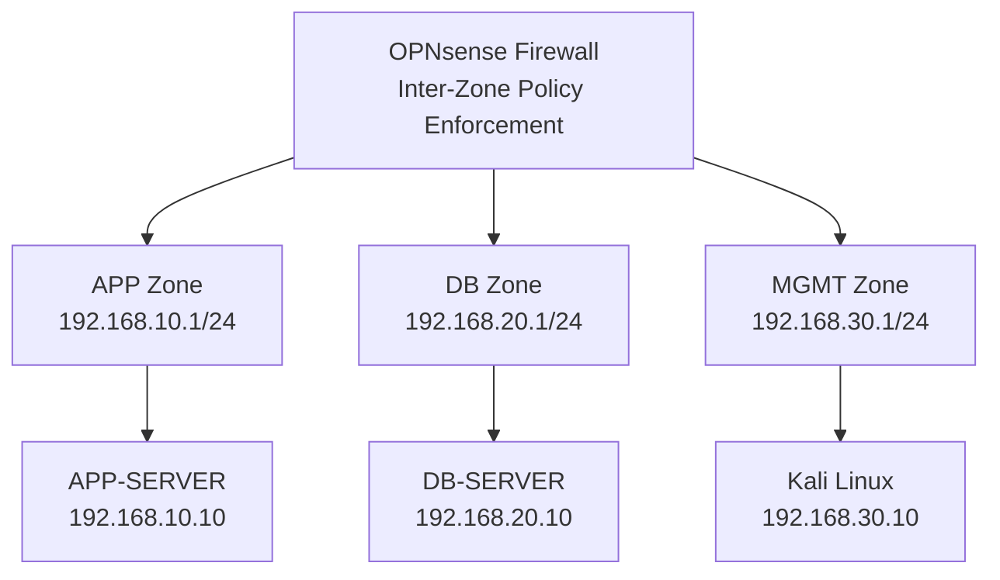

# Enterprise Network Segmentation & Security Architecture

**Security Architecture | Network Segmentation | Risk Assessment | Firewall Validation**

An end-to-end cybersecurity architecture case study combining enterprise security design, risk assessment, and hands-on network segmentation validation using OPNsense.

The project demonstrates how security requirements are translated into architecture decisions, firewall policies, and practical validation evidence.

## Project Highlights

- Designed a segmented network architecture using dedicated Application, Database, and Management zones.
- Implemented least-privilege firewall policies using OPNsense.
- Executed five network connectivity validation scenarios.
- Identified unintended firewall management access caused by an OPNsense anti-lockout rule.
- Remediated the exposure and verified that authorized administrative access remained available.
- Developed a fictional enterprise-scale target architecture with proposed VPN, MFA, DMZ, privileged access, and security monitoring controls.
- Documented security findings, risk assessments, architecture decisions, and requirements traceability.

## Architecture Overview

### Implemented Laboratory

The practical environment was deployed in Oracle VirtualBox.

| Component | Technology / Address |
|---|---|
| Segmentation Firewall | OPNsense |
| Application Server | Debian Linux — `192.168.10.10` |
| Database Test Server | Debian Linux — `192.168.20.10` |
| Management Workstation | Kali Linux — `192.168.30.10` |
| Application Zone | `192.168.10.0/24` |
| Database Zone | `192.168.20.0/24` |
| Management Zone | `192.168.30.0/24` |

All tested inter-zone communication was routed through OPNsense.

A temporary Python listener on TCP port 5432 simulated database service connectivity. PostgreSQL was not deployed.

### Proposed Enterprise Target Architecture

A separate conceptual design for fictional Enterprise X includes:

- Perimeter firewall and controlled VPN access.
- Internal segmentation firewall.
- Corporate, Application, Database, and Management zones.
- DMZ and reverse proxy.
- Privileged access through a hardened jump host.
- MFA and time-bound vendor authorization.
- Centralized security monitoring.

**These enterprise-scale components are proposed design elements and were not implemented in the laboratory.**

## Security Validation Results

Five network connectivity scenarios were executed.

| Test | Expected Behavior | Observed Result | Status |
|---|---|---|---|
| APP → DB TCP/5432 | Allow | Connected | Pass |
| APP → DB TCP/5433 | Deny | Blocked; firewall log confirmed | Pass |
| APP → Firewall MGMT TCP/443 | Deny | Blocked after remediation | Pass |
| DB → Firewall MGMT TCP/443 | Deny | Connection failed; full log correlation incomplete | Partially Evidenced |
| Kali → Firewall MGMT TCP/443 | Allow | Connected | Pass |

**Validation Summary**

- **5** connectivity scenarios executed.
- **4** scenarios passed with supporting validation.
- **1** scenario partially evidenced.
- **1** observed security finding remediated and retested.

## Key Security Finding

### Unintended Management Access — OPNsense Anti-Lockout Rule

During validation, the Application Server unexpectedly established a TCP connection to the OPNsense HTTPS management interface.

Firewall log analysis identified the built-in anti-lockout rule as the permitting rule.

**Remediation performed:**

1. Confirmed authorized management connectivity from Kali Linux.
2. Disabled the administration anti-lockout rule.
3. Preserved the explicit authorized management access policy.
4. Retested application-to-management connectivity.
5. Confirmed the unauthorized connection was blocked.

**Outcome:** The unintended management access path was removed for the tested application host without disrupting authorized administration.

This finding demonstrates why firewall architecture validation must include automatically generated rules and observed traffic behavior, not only manually configured policies.

## Project Documentation

The project follows a structured security architecture lifecycle.

| # | Document | Description |
|---|---|---|
| 01 | [Business & Security Requirements](01-business-security-requirements.md) | Business objectives, security requirements, and scope |
| 02 | [Current Architecture](02-current-architecture.md) | Fictional enterprise baseline and trust boundaries |
| 03 | [Traffic Flow Matrix](03-traffic-flow-matrix.md) | Assumed enterprise flows and observed laboratory traffic |
| 04 | [Security Assessment Findings](04-security-assessment-findings.md) | Hypothetical findings and observed laboratory security issue |
| 05 | [Risk Assessment & Register](05-risk-assessment-register.md) | Risk evaluation, treatment, and residual risk |
| 06 | [Secure Architecture Design](06-proposed-secure-architecture.md) | Implemented lab and proposed enterprise target design |
| 07 | [Architecture Decision Records](07-architecture-decision-records.md) | Design rationale, alternatives, and trade-offs |
| 08 | [Security Validation Plan & Results](08-security-validation-plan.md) | Executed tests, results, and evidence requirements |
| 09 | [Target-State Traffic Flow Matrix](09-Target-State-Traffic-Flow-Matrix.md) | Implemented lab policies and proposed enterprise policies |
| 10 | [Requirements Traceability Matrix](10-requirements-traceability-matrix.md) | Requirements-to-controls-to-validation mapping |

## Methodology

1. **Requirements Definition:** Identify business objectives and security requirements.
2. **Architecture Assessment:** Review network boundaries and communication flows.
3. **Risk Assessment:** Identify and prioritize security risks.
4. **Secure Design:** Develop segmentation architecture and access policies.
5. **Architecture Decisions:** Document alternatives, rationale, and trade-offs.
6. **Implementation:** Configure selected security controls in the laboratory.
7. **Validation:** Execute connectivity tests and review firewall logs.
8. **Remediation:** Investigate unexpected access and verify corrective actions.
9. **Traceability:** Map requirements to controls, findings, and validation results.

## Technologies & Security Concepts

**Technologies:** OPNsense, Oracle VirtualBox, Debian Linux, Kali Linux.

**Security Concepts:** Network Segmentation, Security Architecture, Firewall Policy Design, Least Privilege, Default Deny, Security Risk Assessment, Security Assurance, Architecture Decision Records, Requirements Traceability.

## Project Status

**Core Documentation:** Completed

**Laboratory Implementation:** Completed for the documented test scope

**Validation:** Five scenarios executed; four passed with supporting validation and one partially evidenced

**Evidence Publication:** Published — [View Validation Evidence](evidence/README.md)

**Enterprise Target Architecture:** Proposed — Not Implemented

## Scope and Limitations

This is an independently developed cybersecurity portfolio project.

Enterprise X is fictional. The practical laboratory uses isolated virtual machines and does not represent a production deployment.

The project does not claim to demonstrate production PostgreSQL security, enterprise VPN, MFA, SIEM integration, jump-host deployment, high availability, or comprehensive penetration testing.

All results are limited to the documented test scenarios.

## Disclaimer

All organizational details, enterprise architecture assumptions, and scenario-based risks are fictional. The implemented laboratory and its documented validation results are presented for educational and professional portfolio purposes only.
