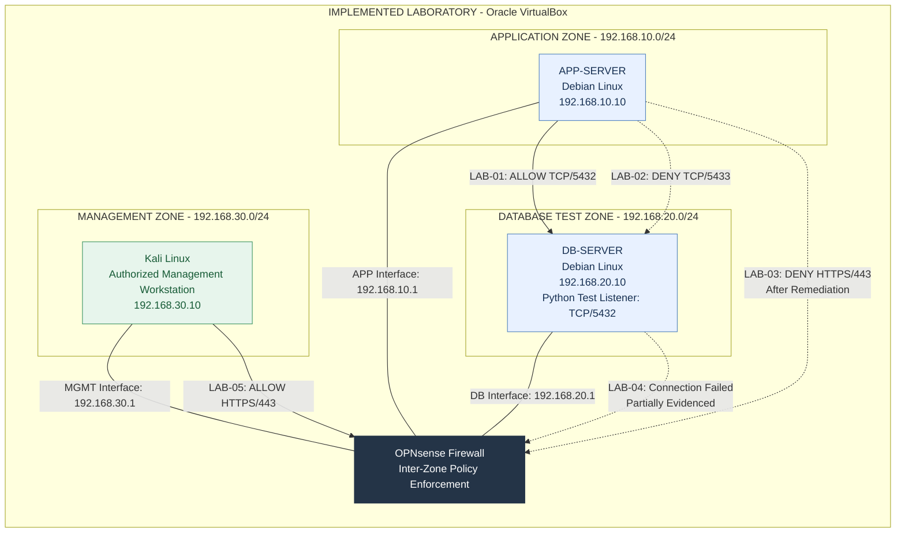
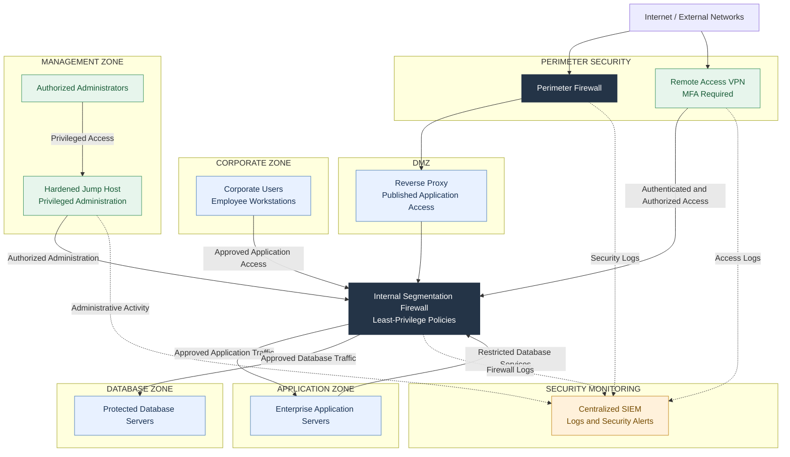

# Enterprise Network Segmentation & Security Architecture

**Security Architecture | Network Segmentation | Risk Assessment | Firewall Validation**

An end-to-end cybersecurity architecture case study combining enterprise security design, risk assessment, and hands-on network segmentation validation using OPNsense.

The project demonstrates how security requirements are translated into architecture decisions, firewall policies, and practical validation evidence.

> **Project Scope:** The network segmentation laboratory was implemented and tested. The broader Enterprise X target architecture is a proposed design and was not deployed.

## Project Highlights

- Designed and implemented a segmented laboratory network with dedicated Application, Database, and Management zones.
- Configured least-privilege firewall policies using OPNsense.
- Executed five network connectivity validation scenarios.
- Identified unintended firewall management access caused by an OPNsense anti-lockout rule.
- Remediated the unintended access and verified that authorized administrative access remained available.
- Designed a fictional enterprise target architecture incorporating VPN, MFA, DMZ, privileged access, and centralized security monitoring.
- Documented security findings, risk assessments, architecture decisions, validation evidence, and requirements traceability.

## Architecture Overview

### Implemented Laboratory

The practical environment was deployed using Oracle VirtualBox, OPNsense, Debian Linux, and Kali Linux.

| Component | Technology / Address |
|---|---|
| Segmentation Firewall | OPNsense |
| Application Server | Debian Linux — `192.168.10.10` |
| Database Test Server | Debian Linux — `192.168.20.10` |
| Management Workstation | Kali Linux — `192.168.30.10` |
| Application Zone | `192.168.10.0/24` |
| Database Zone | `192.168.20.0/24` |
| Management Zone | `192.168.30.0/24` |
| Firewall APP Interface | `192.168.10.1` |
| Firewall DB Interface | `192.168.20.1` |
| Firewall MGMT Interface | `192.168.30.1` |

#### Implemented Lab Architecture — Network Diagram

The diagram shows the deployed security zones and the communication paths covered by laboratory validation.

**Diagram Legend**

- **Solid arrows:** Tested and permitted communication.
- **Dashed arrows:** Tested communication that was denied or failed.
- **LAB-04:** Connection failure was observed, but complete firewall-log correlation remains unavailable.

The OPNsense firewall provides policy enforcement between the three security zones.

A temporary Python HTTP listener on TCP port `5432` simulated database service connectivity. PostgreSQL was not deployed.

The diagram represents selected tested communication paths, not an exhaustive list of all possible network flows.

### Proposed Enterprise Target Architecture

A separate conceptual design for fictional Enterprise X includes:

- Perimeter firewall and controlled VPN access.
- Internal segmentation firewall.
- Corporate, Application, Database, and Management zones.
- DMZ and reverse proxy.
- Privileged access through a hardened jump host.
- MFA and time-bound vendor authorization.
- Centralized security monitoring.

**These enterprise-scale components are proposed design elements and were not implemented in the laboratory.**

For additional design details, see the [Secure Architecture Design](06-proposed-secure-architecture.md).

#### Proposed Enterprise Architecture — Network Diagram

> **Design Status:** Proposed only. The components below were not deployed or validated in the laboratory.

**Architecture Principles**

- **Defense in Depth:** Separate perimeter protection from internal segmentation.
- **Least Privilege:** Allow only approved communication between security zones.
- **Controlled Remote Access:** Require MFA and destination-specific authorization.
- **Privileged Access Security:** Route administrative access through a controlled jump host.
- **Centralized Monitoring:** Forward relevant security events to the SIEM.
- **Default Deny:** Restrict communication that is not explicitly authorized.

The diagram is a high-level conceptual design. Detailed communication restrictions are defined in the [Target-State Traffic Flow Matrix](09-Target-State-Traffic-Flow-Matrix.md).

**Implementation Status:** Conceptual enterprise design. VPN, MFA, DMZ, jump host, SIEM, and enterprise segmentation controls were not implemented or tested.

## Security Validation Results

Five network connectivity scenarios were executed to evaluate selected firewall policies and management access restrictions.

| Test ID | Communication Path | Expected Behavior | Observed Result | Status |
|---|---|---|---|---|
| LAB-01 | APP → DB TCP/5432 | Allow | Connected | Pass |
| LAB-02 | APP → DB TCP/5433 | Deny | Connection blocked; firewall log confirmed | Pass |
| LAB-03 | APP → Firewall MGMT TCP/443 | Deny | Blocked after remediation | Pass |
| LAB-04 | DB → Firewall MGMT TCP/443 | Deny | Connection failed; complete firewall-log correlation unavailable | Partially Evidenced |
| LAB-05 | Kali → Firewall MGMT TCP/443 | Allow | Connected | Pass |

### Validation Summary

- **5** connectivity scenarios executed.
- **4** scenarios passed with supporting validation.
- **1** scenario partially evidenced.
- **1** observed security finding remediated and retested.

**[View Security Validation Evidence](evidence/README.md)**

The evidence register includes screenshots supporting selected test results, the initial anti-lockout finding, and the post-remediation firewall behavior.

## Key Security Finding

### Unintended Management Access — OPNsense Anti-Lockout Rule

During validation, the Application Server unexpectedly established a TCP connection to the OPNsense HTTPS management interface.

Firewall log analysis identified the built-in anti-lockout rule as the permitting rule.

This behavior conflicted with the intended management isolation policy.

**Remediation performed:**

1. Confirmed authorized management connectivity from Kali Linux.
2. Disabled the OPNsense administration anti-lockout rule.
3. Preserved the explicit authorized management access policy.
4. Retested application-to-management connectivity.
5. Confirmed the unauthorized connection was blocked.

**Outcome:** The unintended management access path was removed for the tested application host without disrupting authorized administration.

This finding demonstrates why firewall security validation must include automatically generated rules and observed traffic behavior, not only manually configured policies.

The finding was a firewall configuration and policy interaction, not evidence of an OPNsense software vulnerability.

## Project Documentation

The project follows a structured security architecture lifecycle.

| # | Document | Description |
|---|---|---|
| 01 | [Business & Security Requirements](01-business-security-requirements.md) | Business objectives, security requirements, and scope |
| 02 | [Current Architecture](02-current-architecture.md) | Fictional enterprise baseline and trust boundaries |
| 03 | [Traffic Flow Matrix](03-traffic-flow-matrix.md) | Assumed enterprise flows and observed laboratory traffic |
| 04 | [Security Assessment Findings](04-security-assessment-findings.md) | Hypothetical findings and observed laboratory security issue |
| 05 | [Risk Assessment & Register](05-risk-assessment-register.md) | Risk evaluation, treatment, and residual risk |
| 06 | [Secure Architecture Design](06-proposed-secure-architecture.md) | Implemented laboratory and proposed enterprise target design |
| 07 | [Architecture Decision Records](07-architecture-decision-records.md) | Design rationale, alternatives, and trade-offs |
| 08 | [Security Validation Plan & Results](08-security-validation-plan.md) | Executed tests, results, and evidence requirements |
| 09 | [Target-State Traffic Flow Matrix](09-Target-State-Traffic-Flow-Matrix.md) | Implemented laboratory policies and proposed enterprise policies |
| 10 | [Requirements Traceability Matrix](10-requirements-traceability-matrix.md) | Requirements-to-controls-to-validation mapping |

### Supporting Evidence

[Security Validation Evidence Register](evidence/README.md) — Screenshots and explanations documenting selected firewall validation results.

## Methodology

1. **Requirements Definition:** Identify business objectives and security requirements.
2. **Architecture Assessment:** Review network boundaries and communication flows.
3. **Risk Assessment:** Identify and prioritize security risks.
4. **Secure Design:** Develop segmentation architecture and access policies.
5. **Architecture Decisions:** Document alternatives, rationale, and trade-offs.
6. **Implementation:** Configure selected security controls in the laboratory.
7. **Validation:** Execute connectivity tests and review firewall logs.
8. **Remediation:** Investigate unexpected access and verify corrective actions.
9. **Traceability:** Map requirements to controls, findings, and validation results.

## Technologies & Security Concepts

**Technologies:** OPNsense, Oracle VirtualBox, Debian Linux, Kali Linux.

**Security Concepts:** Security Architecture, Network Segmentation, Firewall Policy Design, Least Privilege, Default Deny, Security Risk Assessment, Security Assurance, Architecture Decision Records, Requirements Traceability.

## Project Status

| Area | Status |
|---|---|
| Core Documentation | Completed |
| Laboratory Implementation | Completed for the documented test scope |
| Security Validation | 5 scenarios executed; 4 passed with supporting validation and 1 partially evidenced |
| Evidence Publication | [Published — View Evidence](evidence/README.md) |
| Enterprise Target Architecture | Proposed — Not Implemented |

## Scope and Limitations

This is an independently developed cybersecurity portfolio project.

Enterprise X is fictional. The practical laboratory uses isolated virtual machines and does not represent a production deployment.

The laboratory demonstrates selected network security controls and does not claim to establish:

- Production PostgreSQL database security.
- Application-level authentication or authorization.
- Enterprise VPN or MFA implementation.
- SIEM integration or centralized alerting.
- Jump-host deployment.
- DMZ or reverse-proxy deployment.
- Firewall high availability or disaster recovery.
- Comprehensive penetration testing.
- Regulatory compliance certification.

All implementation and validation claims are limited to the documented laboratory scope.

## Disclaimer

All organizational details, enterprise architecture assumptions, and scenario-based risks are fictional.

The implemented laboratory and its documented validation results are presented for educational and professional portfolio purposes only.
