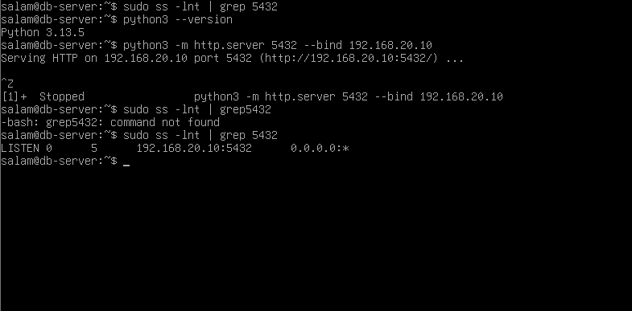
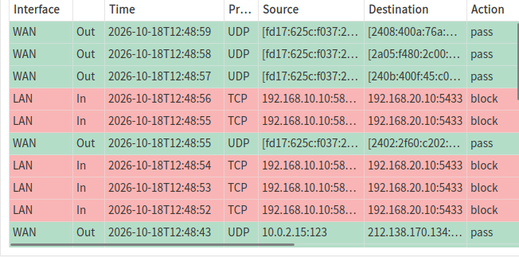
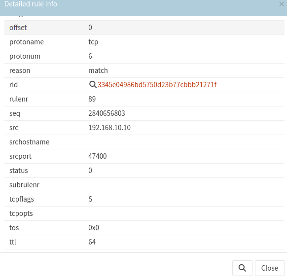
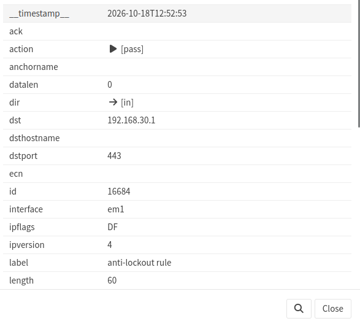
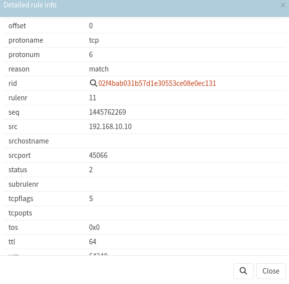
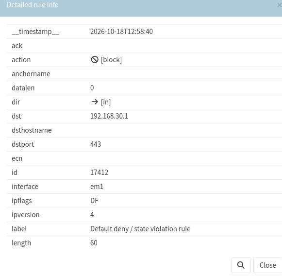
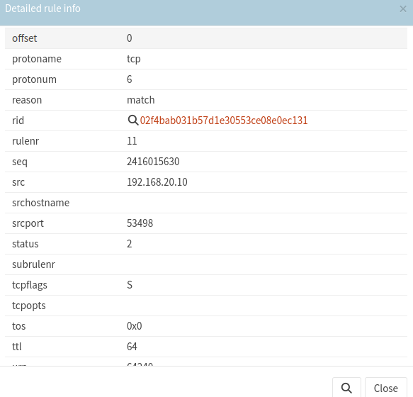
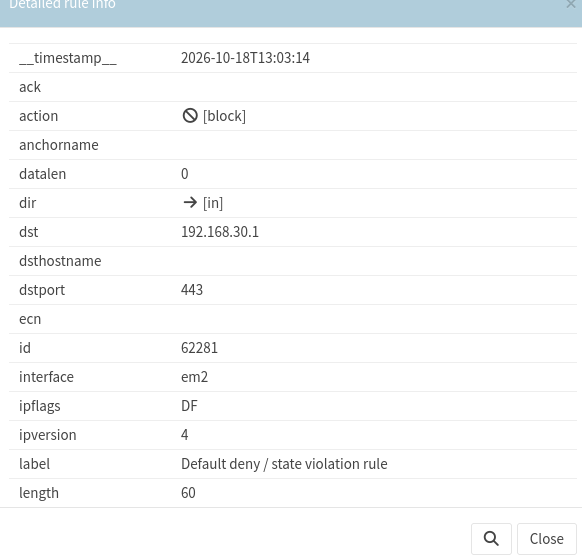

# Security Validation Evidence# Security Validation Evidence

## Overview

This directory contains selected evidence from the OPNsense network segmentation laboratory.

The evidence supports the documented security validation activities, including:

- Approved application-to-database connectivity.
- Blocking of unauthorized database service ports.
- Identification of unintended firewall management access.
- Remediation and retesting of the management access issue.
- Investigation of database-to-management connectivity.

The screenshots are retained as original laboratory evidence.

## Evidence Index

| Evidence ID | Files | Description | Related Test |
|---|---|---|---|
| EV-01 | [Application-to-Database Test](EV-01_app_db_test_terminal.png) | Terminal-based connectivity test evidence | LAB-01 |
| EV-02 | [Blocked TCP/5433 Traffic](EV-02_app_db_5433_block_log.png) | Firewall log showing denied APP-to-DB traffic on TCP/5433 | LAB-02 |
| EV-03 | [Source Details](EV-03_anti_lockout_pass_source.png), [Destination and Rule Details](EV-03_anti_lockout_pass_destination.png) | Evidence of traffic permitted by the OPNsense anti-lockout rule | LAB-03 |
| EV-04 | [Source Details](EV-04_post_remediation_block_source.png), [Destination and Rule Details](EV-04_post_remediation_block_destination.png) | Evidence of blocked APP-to-MGMT traffic after remediation | LAB-03 |
| EV-05 | [Source Details](EV-05_db_mgmt_log_source.png), [Destination Details](EV-05_db_mgmt_log_destination.png) | Supporting details for DB-to-MGMT connectivity investigation | LAB-04 |

## EV-01: Application-to-Database Connectivity

**Test:** LAB-01  
**Expected Result:** Allow TCP/5432  
**Observed Result:** Connection successful  
**Status:** Pass

The test used a temporary Python HTTP listener on TCP port 5432 to simulate database service reachability.

PostgreSQL was not installed, and no database authentication or queries were performed.

## EV-02: Unauthorized Database Port Blocked

**Test:** LAB-02  
**Expected Result:** Deny TCP/5433  
**Observed Result:** Firewall block  
**Status:** Pass

The firewall log records blocked communication from the application server to the database test server on TCP port 5433.

This supports validation of the selected least-privilege firewall policy.

## EV-03: Unintended Management Access Before Remediation

**Test:** LAB-03  
**Finding:** LAB-F-01  
**Observed Result:** Traffic permitted by the anti-lockout rule

### Source Details

### Destination and Firewall Rule Details

The collected evidence identifies an application-zone source and the OPNsense management destination on TCP/443.

The firewall rule details identify the built-in `anti-lockout rule` as the permitting rule.

This behavior was inconsistent with the intended management access restrictions.

## EV-04: Management Access Blocked After Remediation

**Test:** LAB-03  
**Finding:** LAB-F-01  
**Expected Result:** Deny APP-to-MGMT TCP/443  
**Observed Result:** Firewall block  
**Status:** Pass after remediation

### Source Details

### Destination and Firewall Rule Details

After disabling the administration anti-lockout rule, the application-to-management connection was blocked.

The firewall log identifies `Default deny / state violation rule` as the blocking rule.

Authorized management access from the Kali Linux workstation was separately confirmed to remain available.

## EV-05: Database-to-Management Investigation

**Test:** LAB-04  
**Expected Result:** Deny DB-to-MGMT TCP/443  
**Observed Result:** Connection failed  
**Status:** Partially Evidenced

### Source Details

### Destination Details

The test observed failed connectivity from the database server to the firewall management interface.

The available screenshots provide supporting log details, but complete event correlation and rule attribution are not established by the retained evidence.

Therefore, the test is not represented as a fully verified firewall block.

## Evidence Limitations

- Screenshots represent selected laboratory activities, not a comprehensive firewall audit.
- A successful TCP connection does not establish application-level authorization.
- A failed connection alone does not prove firewall enforcement.
- The evidence does not demonstrate enterprise VPN, MFA, SIEM, jump-host, or high-availability controls.
- All laboratory addresses belong to an isolated educational environment.

## Related Documentation

- [Security Validation Plan & Results](../08-security-validation-plan.md)
- [Security Assessment Findings](../04-security-assessment-findings.md)
- [Architecture Decision Records](../07-architecture-decision-records.md)
- [Requirements Traceability Matrix](../10-requirements-traceability-matrix.md)

---

*This evidence was collected from an independently developed educational security architecture laboratory.*
